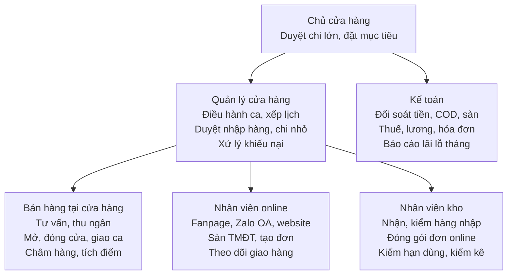

# Quy trình làm việc Sunny Mẹ và Bé

Cập nhật: 15/10/2026

## Mục đích và nguyên tắc chung

Tài liệu này là chuẩn làm việc chung cho mọi nhân viên của Sunny Mẹ và Bé, áp dụng cho cửa hàng tại 86A Nguyễn Viết Xuân, Pleiku và các kênh online (website sunnymevabe.com, fanpage, Zalo OA, sàn TMĐT). Mục tiêu là mỗi việc đều có người chịu trách nhiệm, làm theo cùng một cách và có số liệu để kiểm tra.

**Năm nguyên tắc khi làm việc**

1. **An toàn cho mẹ và bé là trên hết:** không bán hàng hết hạn, không rõ nguồn gốc hoặc hư hỏng bao bì; tư vấn đúng độ tuổi, không hứa hẹn công dụng như thuốc.
2. **Mọi giao dịch đều qua phần mềm bán hàng:** không bán "ngoài sổ", không thu tiền mà không xuất phiếu hoặc hóa đơn.
3. **Có chứng từ mới có thu chi:** mọi khoản tiền vào, ra đều có phiếu, hóa đơn hoặc giấy báo ngân hàng kèm theo.
4. **Khách hàng được phản hồi nhanh:** tin nhắn online trả lời trong 15 phút giờ làm việc; khiếu nại báo quản lý trong ngày.
5. **Ghi lại và cải tiến:** sự cố, khiếu nại, hàng lỗi đều được ghi sổ để rút kinh nghiệm hằng tháng.

## Sơ đồ tổ chức và vai trò

Cửa hàng có ba nhóm việc do quản lý điều hành, còn kế toán báo cáo trực tiếp chủ cửa hàng để tách người giữ tiền khỏi người kiểm tiền.

Một người có thể kiêm nhiều vai trò khi cửa hàng còn ít nhân sự, nhưng người thu tiền không đồng thời là người đối soát tiền.

## Vận hành cửa hàng hằng ngày

Mỗi ca có một trưởng ca chịu trách nhiệm mở, bàn giao hoặc đóng cửa theo checklist dưới đây và ký sổ giao ca.

**Mở cửa (trước giờ mở cửa 30 phút)**

- [ ] Mở khóa, bật đèn, điều hòa, máy tính tiền, máy in, máy quẹt thẻ
- [ ] Kiểm tra tiền quỹ đầu ca, ghi số vào sổ giao ca
- [ ] Vệ sinh sàn, kệ, quầy thu ngân, khu thử đồ cho bé
- [ ] Châm hàng lên kệ, kiểm tra tem giá, đưa hàng cận hạn lên vị trí dễ thấy
- [ ] Xem tin nhắn, đơn online tồn từ tối hôm trước và chia việc
- [ ] Họp đầu ca 5 phút: chương trình khuyến mãi, hàng mới, chỉ tiêu ngày

**Trong ca**

- Luôn có ít nhất 1 người ở quầy thu ngân và 1 người tư vấn trên khu bán hàng.
- Châm hàng và dọn kệ khi vắng khách; ghi hàng sắp hết vào sổ đề xuất nhập.
- Đơn online được xử lý theo khung giờ cố định: 10h, 14h và 17h.

**Giao ca và đóng cửa**

- [ ] Kết ca trên phần mềm, in báo cáo doanh thu ca
- [ ] Đếm tiền mặt, đối chiếu với báo cáo và chuyển khoản, quẹt thẻ; ghi chênh lệch nếu có
- [ ] Bàn giao tiền và sổ giao ca cho ca sau hoặc nộp quỹ cho quản lý
- [ ] Dọn dẹp, sắp xếp lại kệ, kiểm tra hàng giá trị cao
- [ ] Tắt thiết bị, kiểm tra điện nước, khóa cửa, bật camera và báo động

## Bán hàng tại cửa hàng

Mỗi khách vào cửa hàng đều đi qua 6 bước, từ chào đón đến cảm ơn, và mọi đơn đều được ghi nhận trên phần mềm kèm số điện thoại khách.

1. **Chào đón:** chào trong 10 giây đầu, hỏi nhu cầu và độ tuổi hoặc cân nặng của bé.
2. **Tư vấn:** giới thiệu 2–3 lựa chọn phù hợp ngân sách; với sữa, bỉm, đồ ăn dặm luôn kiểm tra hạn dùng trước khi đưa khách.
3. **Gợi ý thêm:** đề xuất sản phẩm đi kèm (bình sữa đi với núm ti, bỉm đi với khăn ướt) và chương trình khuyến mãi đang chạy.
4. **Thanh toán:** quét mã sản phẩm, nhập số điện thoại để tích điểm, đọc lại tổng tiền; nhận tiền mặt, chuyển khoản hoặc quẹt thẻ; in hóa đơn.
    - Chuyển khoản chỉ giao hàng khi đã thấy tiền vào tài khoản cửa hàng, không dựa vào ảnh chụp màn hình của khách.
    - Khách cần hóa đơn VAT: ghi thông tin công ty, chuyển kế toán xuất trong ngày.
5. **Đóng gói và giao hàng:** kiểm tra lại hàng trước mặt khách, đóng túi, hướng dẫn cách dùng và chính sách đổi trả.
6. **Cảm ơn và mời quay lại:** mời khách theo dõi Zalo OA để nhận ưu đãi và nhắc lịch mua lại (sữa, bỉm).

## Bán hàng online

Đơn từ mọi kênh online được gom về một nơi trên phần mềm bán hàng, xác nhận với khách rồi mới chuyển kho đóng gói, để không sót đơn và không trừ tồn kho hai lần.

| Kênh | Người phụ trách | Thời gian phản hồi | Ghi chú |
| --- | --- | --- | --- |
| Fanpage Facebook | Nhân viên online | ≤ 15 phút | Trả lời tin nhắn và bình luận, không báo giá công khai dưới bình luận |
| Zalo OA | Nhân viên online | ≤ 15 phút | Kênh chăm sóc khách cũ, gửi ưu đãi và nhắc mua lại |
| Website sunnymevabe.com | Nhân viên online | ≤ 1 giờ | Gọi xác nhận mọi đơn mới |
| Sàn TMĐT (Shopee, TikTok Shop) | Nhân viên online | Theo quy định sàn | Xác nhận và giao cho vận chuyển đúng hạn để tránh bị phạt |

**Các bước xử lý một đơn online**

1. **Tiếp nhận:** trả lời khách, tư vấn, chốt sản phẩm, địa chỉ và số điện thoại.
2. **Tạo đơn:** nhập đơn vào phần mềm, ghi kênh bán và hình thức thanh toán (COD hoặc chuyển khoản).
3. **Xác nhận:** gọi hoặc nhắn xác nhận với khách; đơn chuyển khoản chỉ đi khi đã nhận tiền.
4. **Đóng gói:** kho lấy hàng theo phiếu, kiểm tra hạn dùng, đóng gói chống sốc, quay video khi đóng gói đơn giá trị cao.
5. **Giao hàng:** in vận đơn, bàn giao cho đơn vị vận chuyển, gửi mã vận đơn cho khách.
6. **Theo dõi:** kiểm tra đơn giao thất bại hằng ngày, gọi lại khách trước khi cho hoàn.
7. **Đối soát COD:** kế toán đối chiếu tiền thu hộ với đơn vị vận chuyển hằng tuần.

## Nhập hàng và quản lý kho

Hàng chỉ được nhập khi có đề xuất được duyệt và chỉ lên kệ sau khi kiểm đủ số lượng, hạn dùng và hóa đơn; hàng ra kệ theo nguyên tắc hết hạn trước, xuất trước.

**Nhập hàng**

1. **Đề xuất:** nhân viên ghi hàng sắp hết vào sổ đề xuất; quản lý tổng hợp dựa trên tồn kho tối thiểu và doanh số tuần.
2. **Duyệt và đặt hàng:** quản lý duyệt số lượng, giá; đặt hàng với nhà cung cấp đã được duyệt, có giấy tờ nguồn gốc.
3. **Nhận và kiểm hàng:** đối chiếu số lượng, mã hàng với đơn đặt và hóa đơn; kiểm tra hạn dùng, tem phụ tiếng Việt, bao bì.
    - Hàng sữa, ăn dặm còn dưới 6 tháng hạn: từ chối hoặc ghi chú để bán ưu tiên.
    - Thiếu, sai hoặc hỏng: lập biên bản ngay với bên giao, chụp ảnh.
4. **Nhập phần mềm:** tạo phiếu nhập kho, đính kèm ảnh hóa đơn; chuyển hóa đơn gốc cho kế toán trong ngày.
5. **Lên kệ:** dán tem giá, xếp hàng mới vào trong, hàng cũ ra ngoài.

**Quản lý kho**

- Kho sạch, khô, không để hàng sát sàn hoặc dưới nắng trực tiếp; sữa và đồ ăn dặm tách riêng khỏi hóa chất tẩy rửa.
- Kiểm hạn dùng hằng tuần: hàng còn dưới 3 tháng đưa vào danh sách xả hàng, báo quản lý.
- Kiểm kê toàn bộ cuối mỗi tháng; kiểm kê đột xuất nhóm hàng giá trị cao (sữa, máy hút sữa, xe đẩy).
- Chênh lệch kiểm kê lập biên bản, ghi rõ nguyên nhân và người chịu trách nhiệm.
- Hàng hỏng, hết hạn: lập biên bản hủy có chữ ký quản lý, không tự ý vứt bỏ.

## Chăm sóc khách hàng, đổi trả và khiếu nại

Khách quay lại mua sữa, bỉm định kỳ là nguồn doanh thu ổn định nhất, nên mọi khách đều được lưu thông tin, nhắc mua lại và xử lý khiếu nại trong 24 giờ.

**Chăm sóc sau bán**

- Lưu số điện thoại, tên mẹ, tuổi bé trên phần mềm cho mọi đơn hàng.
- Nhắc mua lại qua Zalo OA khi gần hết sữa, bỉm theo chu kỳ khách thường mua.
- Gửi lời chúc và ưu đãi vào sinh nhật bé, các dịp 1/6, Tết.

**Chính sách đổi trả (đề xuất)**

| Trường hợp | Thời hạn | Điều kiện | Cách xử lý |
| --- | --- | --- | --- |
| Hàng lỗi do nhà sản xuất | 7 ngày | Có hóa đơn, còn bao bì | Đổi mới hoặc hoàn tiền |
| Đổi size, mẫu quần áo, giày | 7 ngày | Chưa sử dụng, còn tem mác | Đổi sản phẩm khác cùng hoặc cao giá hơn |
| Sữa, đồ ăn dặm, bình, núm ti | Không đổi | Đã mở hoặc đã giao | Chỉ đổi khi lỗi nhà sản xuất |
| Giao sai, thiếu hàng online | 3 ngày | Có video mở hàng | Gửi bù hoặc hoàn tiền phần thiếu |

**Xử lý khiếu nại**

1. Lắng nghe, xin lỗi về sự bất tiện, không tranh cãi với khách.
2. Ghi vào sổ khiếu nại: khách, đơn hàng, nội dung, ảnh hoặc video.
3. Nhân viên tự giải quyết trong quyền hạn (đổi hàng theo chính sách); vượt quyền hạn báo quản lý ngay.
4. Phản hồi khách phương án xử lý trong 24 giờ.
5. Gọi lại sau khi xử lý xong để xác nhận khách hài lòng; tổng hợp nguyên nhân trong họp tháng.

## Thu chi, đối soát và báo cáo kế toán

Kế toán đối chiếu tiền mặt, ngân hàng và phần mềm mỗi ngày, công nợ và COD mỗi tuần, và lập báo cáo kết quả kinh doanh mỗi tháng; mọi khoản chi phải có chứng từ và người duyệt.

**Thu chi**

- Khoản chi dưới hạn mức nhỏ (quản lý cửa hàng tự quyết định mức này) được quản lý duyệt; trên hạn mức cần chủ cửa hàng duyệt.
- Mọi khoản chi lập phiếu chi có chữ ký người nhận, kèm hóa đơn hoặc biên nhận.
- Thanh toán nhà cung cấp bằng chuyển khoản theo hóa đơn và lịch công nợ đã thỏa thuận.
- Tiền mặt tồn quỹ cuối ngày vượt mức quy định được nộp vào tài khoản ngân hàng.

**Lịch đối soát và báo cáo**

| Tần suất | Việc | Người làm | Người nhận |
| --- | --- | --- | --- |
| Hằng ngày | Đối chiếu tiền mặt, chuyển khoản, quẹt thẻ với doanh thu trên phần mềm | Kế toán | Quản lý cửa hàng |
| Hằng ngày | Xuất hóa đơn điện tử cho khách yêu cầu | Kế toán | Khách hàng |
| Hằng tuần | Đối soát COD với đơn vị vận chuyển, tiền về từ sàn TMĐT | Kế toán | Quản lý cửa hàng |
| Hằng tuần | Rà soát công nợ phải trả nhà cung cấp | Kế toán | Chủ cửa hàng |
| Hằng tháng | Báo cáo doanh thu theo kênh, nhóm hàng; chi phí; lãi lỗ | Kế toán | Chủ cửa hàng |
| Hằng tháng | Tính lương, BHXH, thuế TNCN | Kế toán | Chủ cửa hàng |
| Theo hạn thuế | Kê khai và nộp thuế GTGT, TNCN; quyết toán năm | Kế toán | Cơ quan thuế |

Chênh lệch tiền khi kết ca được ghi vào sổ, người kết ca giải trình trong ngày; chênh lệch lặp lại báo chủ cửa hàng.

## Nhân sự: tuyển dụng, đào tạo, chấm công, đánh giá

Nhân viên mới được đào tạo theo chính tài liệu này trong tuần đầu, chấm công qua máy hoặc phần mềm, và được đánh giá hằng tháng theo KPI ở phần cuối.

**Tuyển dụng**

1. Quản lý lập đề xuất tuyển: vị trí, số lượng, thời điểm cần, mức lương dự kiến.
2. Đăng tin trên fanpage, Zalo, các nhóm việc làm Pleiku.
3. Phỏng vấn: thái độ phục vụ, kinh nghiệm bán hàng mẹ và bé, khả năng làm ca.
4. Thử việc theo hợp đồng thử việc, có người kèm cặp.

**Đào tạo nhân viên mới (tuần đầu)**

- Ngày 1: nội quy, nguyên tắc chung, quy trình mở và đóng cửa.
- Ngày 2–3: kiến thức sản phẩm theo nhóm (sữa, bỉm, ăn dặm, đồ dùng, quần áo) và cách đọc hạn dùng.
- Ngày 4: phần mềm bán hàng, thanh toán, tích điểm, đổi trả.
- Ngày 5: bán hàng thực tế có người kèm; cuối tuần kiểm tra và đánh giá.

**Chấm công và ca làm**

- Lịch ca được quản lý xếp trước 1 tuần; đổi ca phải báo và được duyệt trước 24 giờ.
- Đi muộn, về sớm, nghỉ không phép xử lý theo nội quy; bảng công chốt ngày cuối tháng chuyển kế toán.

**Đánh giá**

- Hằng tháng: quản lý đánh giá từng người theo KPI và phản hồi trực tiếp.
- Hằng quý: xét thưởng, điều chỉnh lương, đề bạt trưởng ca.

## KPI, biểu mẫu và cập nhật quy trình

Mỗi bộ phận có 2–3 chỉ số đo hằng tháng; mức mục tiêu cụ thể do chủ cửa hàng đặt sau khi có số liệu 3 tháng gần nhất.

| Bộ phận | Chỉ số | Cách đo | Mục tiêu |
| --- | --- | --- | --- |
| Bán hàng tại cửa hàng | Doanh thu, giá trị trung bình mỗi đơn | Báo cáo phần mềm theo nhân viên | Chủ cửa hàng đặt |
| Bán hàng tại cửa hàng | Tỷ lệ đơn có số điện thoại khách | Số đơn có SĐT / tổng đơn | Chủ cửa hàng đặt |
| Online | Thời gian phản hồi tin nhắn | Thống kê fanpage, Zalo OA | ≤ 15 phút |
| Online | Tỷ lệ giao hàng thất bại, hoàn hàng | Số đơn hoàn / tổng đơn gửi | Chủ cửa hàng đặt |
| Kho | Chênh lệch kiểm kê | Giá trị chênh lệch / giá trị tồn | Chủ cửa hàng đặt |
| Kho | Hàng hết hạn phải hủy | Giá trị hàng hủy trong tháng | Chủ cửa hàng đặt |
| Kế toán | Báo cáo và tờ khai đúng hạn | Số lần trễ hạn | 0 |
| Kế toán | Chênh lệch tiền chưa giải trình | Số ca có chênh lệch | 0 |

**Biểu mẫu kèm theo** (cần soạn tiếp)

- [ ] Sổ giao ca và checklist mở, đóng cửa
- [ ] Sổ đề xuất nhập hàng và phiếu kiểm hàng
- [ ] Biên bản kiểm kê, biên bản hủy hàng
- [ ] Sổ khiếu nại khách hàng
- [ ] Phiếu thu, phiếu chi, đề nghị thanh toán
- [ ] Phiếu đánh giá nhân viên hằng tháng

**Cập nhật quy trình:** mọi nhân viên được góp ý trực tiếp trên tài liệu này; quản lý rà soát hằng quý, cập nhật ngày hiệu lực và thông báo thay đổi trong họp đầu ca.
